# DJM-900NXS2 PLUS

Unofficial firmware mod for the Pioneer DJ DJM-900NXS2 that records the mixer's output to a USB stick. Based on the official firmware 2.08.

> **Unofficial and experimental. UPDATING FIRMWARE IS AT YOUR OWN RISK.**
> It can leave a mixer unusable. There is no warranty of any kind, and no one who made or shared it is responsible for any damage or loss.
> So far it has been tested on one mixer; we do not know whether other hardware revisions exist.
> This is not a Pioneer DJ or AlphaTheta product.

DJM-900NXS2 PLUS is meant to sit alongside the stock functions without disrupting them or the way you use the mixer. Without a stick the screens are exactly as stock; with one, a small **READY** sits above BPM, and while recording, the time.

<table>
<tr>
<td align="center">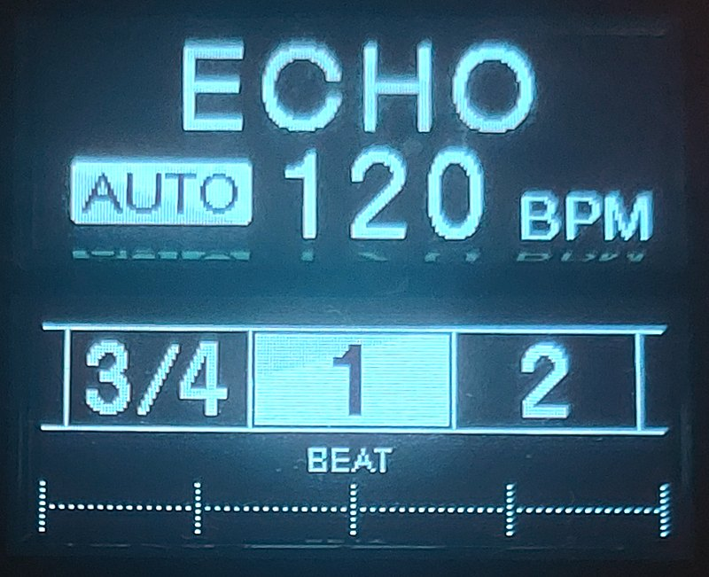 no stick: as stock</td>
<td align="center">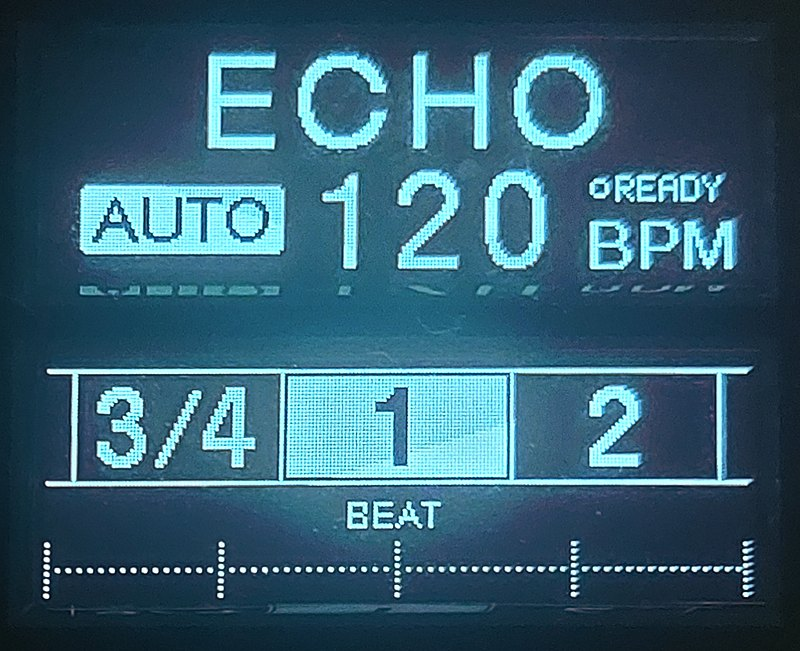 stick in</td>
<td align="center">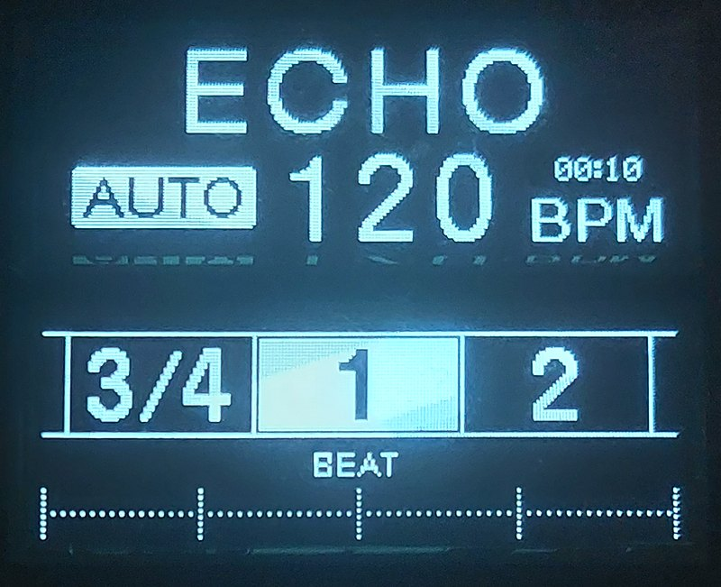 recording</td>
</tr>
</table>

## What it adds

- **Records the REC OUT datastream**, pre-DAC, directly to a USB stick in the mixer's own USB socket.
- **Independent of MASTER LEVEL and BOOTH MONITOR**.
- **Headroom**: the file sits about 16 dB below the master meter's numbers. A meter at +6 is about -10 dBFS in the file. The file only reaches full scale (where it would clip) around the meter's CLIP light.
- **WAV files, 48 kHz stereo, 16 bit** by default, with dither. **24 bit** can be chosen and is experimental.
- **Long recordings**: files of 3 hours (2 at 24 bit) that follow each other without a gap, until the stick is full.
- **MARKER** sets a cue point in the file (up to 100 per file). **CUT** starts a new file without a gap.
- **REC-LOG.TXT** on the stick lists each recording and anything that went wrong.
- After a power cut or a pulled stick, the recording is closed properly at the next start.

## Using it

The mod is meant to complement the stock functions, not disrupt them: REC is one more page in UTILITY, and MASTER OUT and the other pages work as before.

Hold **QUANTIZE (UTILITY)** to open UTILITY. It opens on MASTER OUT as always; **BEAT <** goes to **REC**, and **TAP** opens it:

- **START** / **STOP**, and while recording **MARKER** and **CUT**
- **BIT DEPTH**: 16 BIT or 24 BIT, only while not recording. Every power-on starts at 16 BIT.
- **ABOUT**: the recording time left, the room on the stick, and the version

**BEAT <** and **BEAT >** move, **TAP** chooses, **AUTO/TAP** goes back. While recording, the lower display shows the time and the markers.

<table>
<tr>
<td align="center">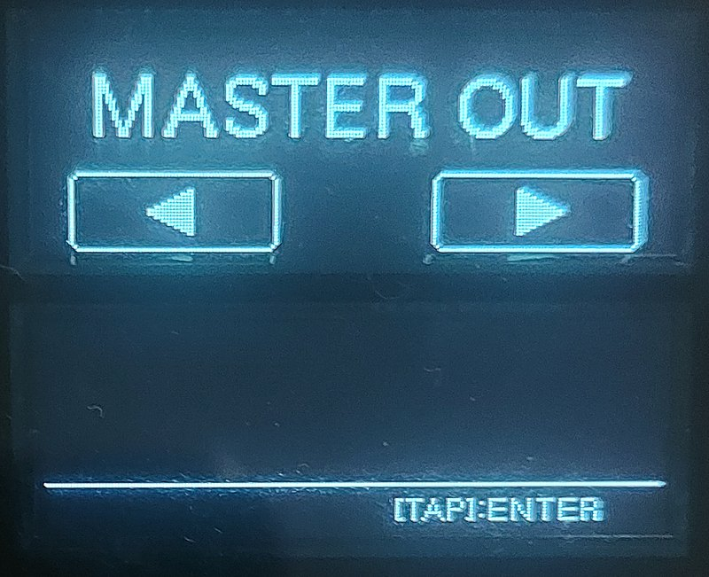 UTILITY: MASTER OUT, as stock</td>
<td align="center">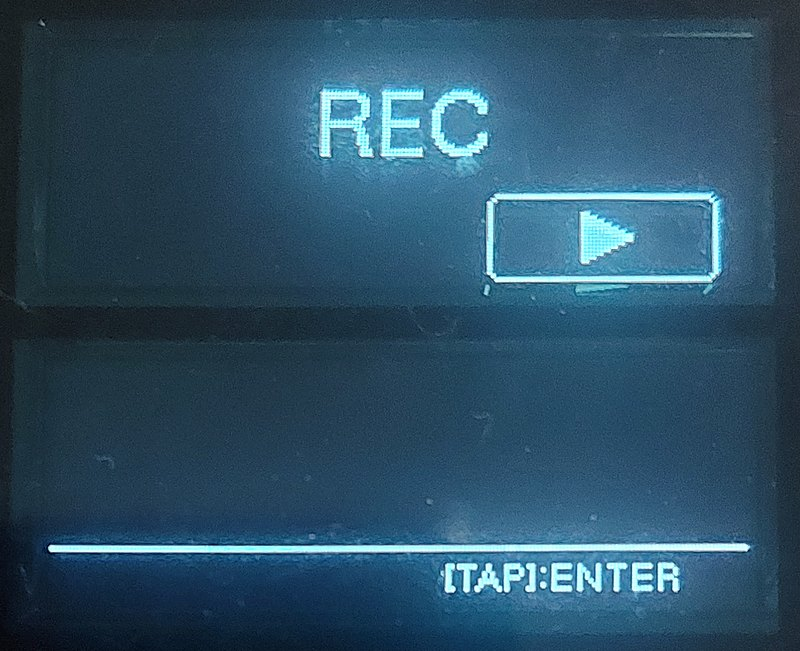 UTILITY: REC</td>
<td align="center">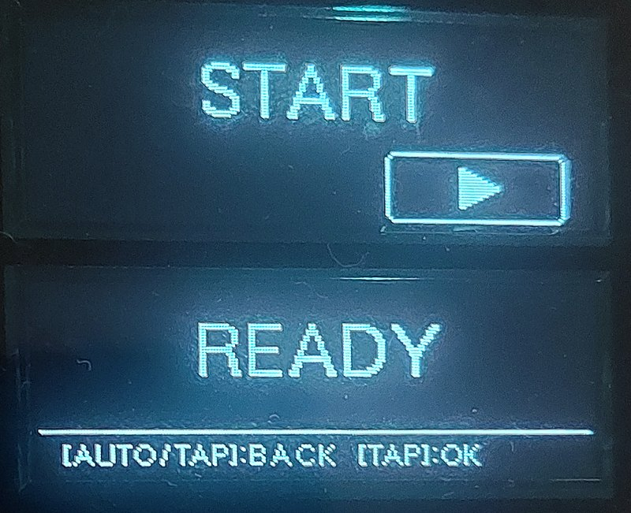 ready</td>
</tr>
<tr>
<td align="center">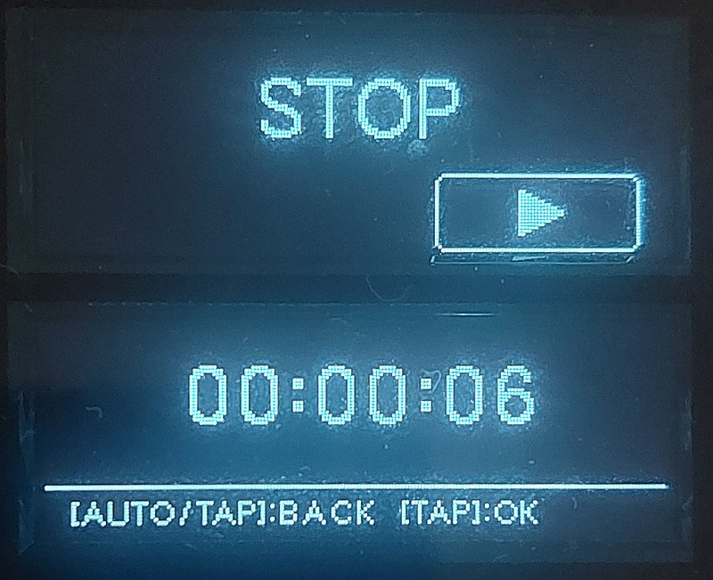 recording</td>
<td align="center">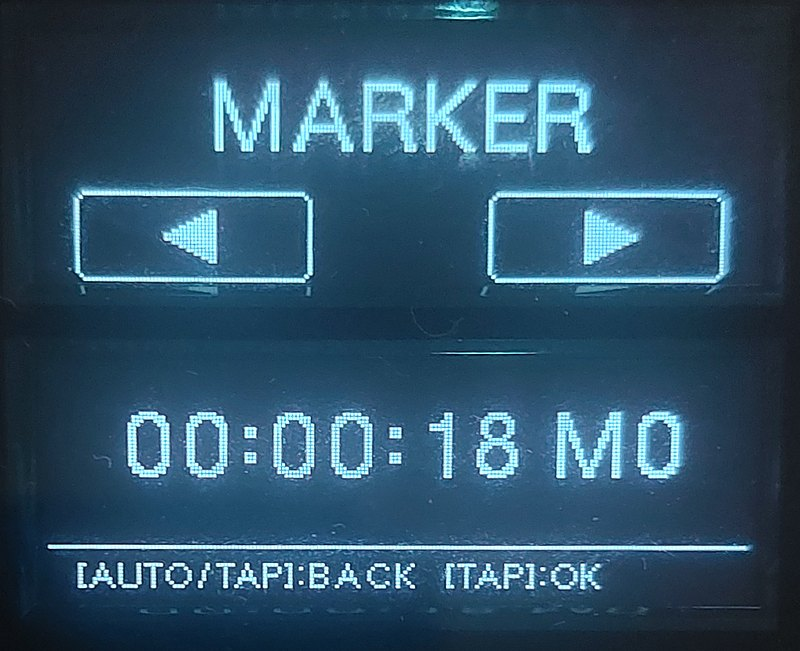 MARKER</td>
<td align="center">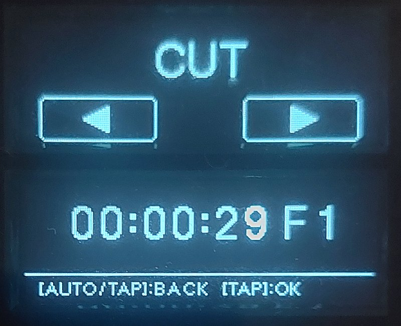 CUT</td>
</tr>
<tr>
<td align="center">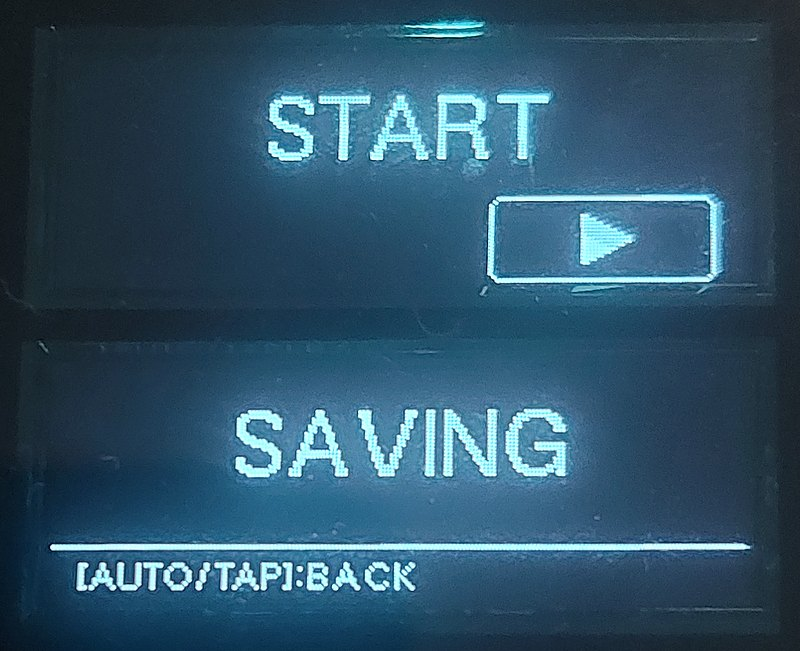 after STOP</td>
<td align="center">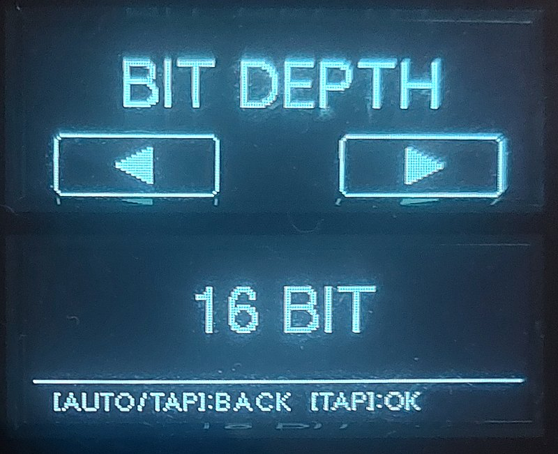 BIT DEPTH</td>
<td align="center">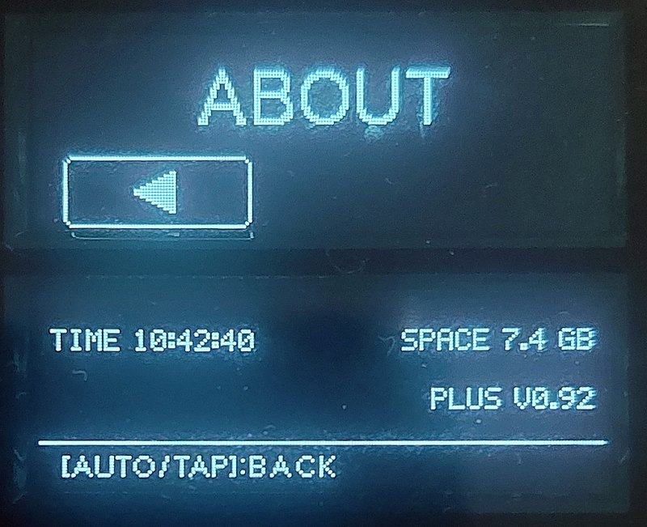 ABOUT</td>
</tr>
</table>

## 16 bit or 24 bit

USB sticks pause now and then, sometimes for seconds. Meanwhile the recorder keeps the sound in a buffer of about 1 MB, all the memory the mixer has to spare.

- **16 BIT** (default): the buffer holds about 8 seconds. In a 7-hour recording in one take nothing was lost, and the buffer was never more than two thirds full.
- **24 BIT** (experimental): 50 % more data, and the buffer holds about 5.5 seconds. When a slow stick fills it to three quarters, the recorder stores the sound with 16 bits until the stick catches up, so the recording goes on without a gap. Each such stretch gets a marker named `16BIT` in the file and a line in REC-LOG.TXT. On the test stick, a 10-hour recording had 36 such stretches, about 3 minutes in all, and nothing was lost.
- A pause longer than the buffer loses sound at either bit depth. In testing this happened once: an earlier build lost 72 ms during a 24-second slowdown of the stick.

How well 24 bit works depends on the stick. Make a long test recording and read REC-LOG.TXT before relying on it.

| | 16 BIT | 24 BIT |
| :--- | :--- | :--- |
| per hour | about 0.7 GB | about 1 GB |
| one file | 3 hours | 2 hours |
| buffer | about 8 s | about 5.5 s |

## Good to know

- 24 bit is experimental: how well it works depends on the stick (see 16 bit or 24 bit above).
- The stick must be FAT32. Other formats show USB ERROR.
- One TAP on STOP ends the recording.
- Every file is dated 1 January 2026: the mixer has no clock.
- The recorder keeps a file of about 2 GB, `DJMREC.TMP`, on the stick so that a recording starts at once. Leave it there.

## Read this first

- This is not a Pioneer DJ or AlphaTheta product. They have nothing to do with it, do not support it, and may refuse service on a modified mixer.
- It is free software under the GNU General Public License version 3, provided as is, with no warranty of any kind.
- You use it entirely at your own risk. In no case is anyone who made or shared it responsible for any damage or loss, to your mixer, your media, your recordings, your gig or anything else.
- It has been tested at length on the author's mixer, with recordings of up to 10 hours. That is not proof that it works the same on yours. Treat it as experimental, and do not rely on it for a show before you have tried it yourself at home.
- A failed or interrupted update can leave a mixer unusable, as with any firmware update. Never switch the mixer off during an update.
- The boot and update code of every chip stays as Pioneer made it, so the mixer's own USB update can always put the official firmware back.
- Keep your official 2.08 UPD file, in case you want to go back to stock.
- Only for the DJM-900NXS2, and only from your own official DJM-900NXS2 firmware version 2.08 UPD file.

## Install

This repository holds no Pioneer firmware. You bring your own official DJM-900NXS2 firmware version 2.08 UPD file and a FAT32 USB stick; the patcher adds the mod to the firmware file on your computer.

1. Download `djm900nxs2_plus_patcher.html` from the [latest release](https://github.com/lowtrustsociety/DJM-900NXS2-PLUS/releases/latest) and open it in a current browser (Chrome, Edge, Firefox or Safari). It works offline: the page cannot load or send anything, and your firmware file never leaves your computer.
2. Drop your official DJM-900NXS2 firmware version 2.08 UPD file onto the page. When it says it is detected, press **build the mod**: the notice opens; read it, tick the box and press **build the mod** there. It checks the result and saves `DJM-900NXS2_092.upd`.
3. The page then shows the steps: copy `DJM-900NXS2_092.upd` to the top folder of the USB stick (keep only one DJM-900NXS2 UPD file on it), eject the stick and plug it back in, and drop the file from the stick onto the page, which tells you whether it is exactly the tested build.
4. With the mixer switched off, put the stick in. Hold **BEAT FX ON/OFF** and **MID** (FX FREQUENCY), switch the mixer on, and keep holding until the update screen appears.
5. Wait for COMPLETE, then switch the mixer off and on again. Do not switch it off before COMPLETE.

The patcher refuses any file that is not the official DJM-900NXS2 firmware version 2.08 UPD file, and it only hands out the mod if the result is, byte for byte, the build that was tested on the mixer (SHA-256 `754ff5361f0f87b07e00f25f06052a27167d939162cc713eff7ff9942c8c2eec`).

The same patcher also comes as a Python script, `patcher/djm900nxs2_plus_patcher.py` in this repository, for those who prefer the command line (Python 3.8 or later; on Windows the command is usually `python`). It does the same, with the same notice and the same checks, and writes the file into the folder `djm900nxs2_plus`. It then shows the same steps and checks the file on the stick: drop it into the terminal window and press enter. To check a file on the stick later:

    python3 patcher/djm900nxs2_plus_patcher.py /path/to/DJM-900NXS2_208.upd
    python3 patcher/djm900nxs2_plus_patcher.py --check /path/to/the/stick/DJM-900NXS2_092.upd

## Going back to stock

Do steps 3 to 5 with your official `DJM-900NXS2_208.upd`, alone on the stick. The mixer takes it because its version differs from the installed one. The mod never touches the boot and update code of any chip.

## Problems

Found a bug? Open an [issue](https://github.com/lowtrustsociety/DJM-900NXS2-PLUS/issues): say what you did and what happened, and attach REC-LOG.TXT. A short recording that shows the problem helps too: each file carries the recorder's own report in its header.

## Building from source

Not needed to use the mod. See [docs/HOW_IT_WORKS.md](docs/HOW_IT_WORKS.md) for what the code does and how to build and test it.

## Support

DJM-900NXS2 PLUS was developed over the course of two months: starting from the official 2.08, it went through more than 70 builds (2.09 to 2.79, then 0.90 to 0.92), most of them tested on the mixer itself, with recordings of up to 10 hours, and a lot of time and tokens along the way. If it is useful to you, you can support it here:

[ko-fi.com/lowtrustsociety](https://ko-fi.com/lowtrustsociety)

## Licence

Copyright (C) 2026 low trust society.

Free software under the **GNU General Public License, version 3** ([LICENSE](LICENSE)). You may use, study, change and share it; if you share it, changed or not, it must stay under the same licence, with its source.

Not covered: **Pioneer's firmware.** It is not in this repository and the licence gives no rights to it.
